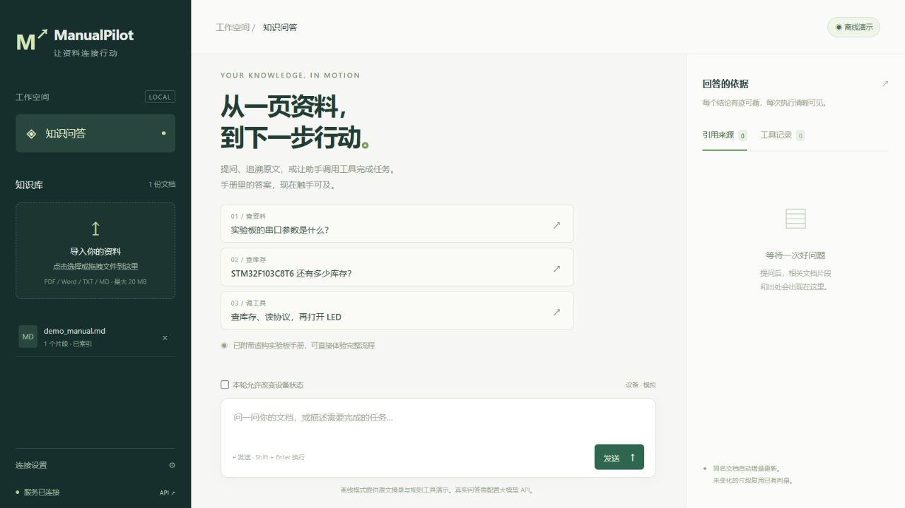
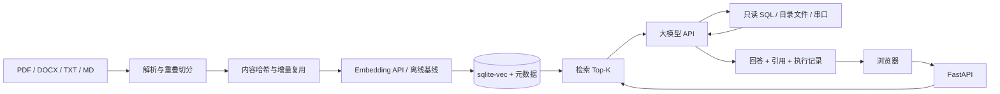

# ManualPilot · 文档与设备助手

基于 **FastAPI + 大模型工具调用 API + sqlite-vec 向量库** 的文档问答服务。支持 PDF / Word 导入、文档增量更新、带来源的检索回答，以及数据库查询、文件读取、串口控制三种工具的连续调用。轻量原生前端与后端同源部署，无需 Node 构建环境。



工具链联调效果与实测范围见 [验收记录](docs/acceptance.md)。

## 功能与实现

| 需求 | 实现 |
| --- | --- |
| 文档导入 | PDF 文本及页码、DOCX 段落和表格、UTF-8 TXT / Markdown；带重叠的分片 |
| 向量检索 | sqlite-vec `vec0` 余弦 KNN；独立可配置的 embedding API、批量请求、查询缓存 |
| 增量更新 | 同名文件视为更新；文件 SHA-256 去重、分片哈希复用向量、事务替换旧版本，删除同步移除向量 |
| 问答 | 先检索，再调用 Chat Completions 兼容 API；返回来源、分片、页码及相似度 |
| Agent | 模型自主选择三种工具，工具结果送回模型继续决策；有轮数、次数、时间预算与重复调用保护 |
| 可观测性 | 每轮 request_id、检索 / 模型 / 工具 / 总耗时、工具参数及实际结果 |
| 部署 | Dockerfile、Compose 持久卷、健康检查、非 root 用户；GitHub Actions 测试及容器冒烟检查 |



## 快速启动

需要 Python 3.11+，推荐使用 3.12。以下命令在仓库根目录执行。

```bash
python -m venv .venv
# Windows PowerShell
.venv\Scripts\Activate.ps1
# Linux / macOS: source .venv/bin/activate
python -m pip install -r requirements.lock
python -m uvicorn app.main:app --host 127.0.0.1 --port 8000
```

访问 [http://127.0.0.1:8000](http://127.0.0.1:8000)，接口文档为 [/docs](http://127.0.0.1:8000/docs)。默认不需要密钥，首次启动自动导入虚构实验板手册与库存，之后保留数据。删除的示例手册不会在重启时重新出现。

默认 `LLM_MODE=demo` 使用**明确标注的规则工具演示与原文摘录**；`EMBEDDING_MODE=hash` 是字符 n-gram 哈希向量，只适合离线联调，跨词义检索能力有限。这两项均不能代表真实大模型或语义 embedding 的效果。

可直接尝试：

- “XH-01 实验板的串口参数是什么？”
- “查询 STM32F103C8T6 的库存和存放位置”
- 勾选“本轮允许改变设备状态”，再问“查询 STM32F103C8T6 库存，读取串口协议并打开 LED”。右侧工具记录可查看三步真实执行结果；默认串口结果为模拟。

## 配置真实模型与语义 embedding

复制 `.env.example` 为 `.env`（Windows：`Copy-Item .env.example .env`），修改后重启：

```dotenv
LLM_MODE=api
LLM_BASE_URL=https://api.openai.com/v1
LLM_API_KEY=填入你的密钥
LLM_MODEL=gpt-4.1-mini
EMBEDDING_MODE=api
EMBEDDING_BASE_URL=https://api.openai.com/v1
EMBEDDING_API_KEY=填入你的密钥
EMBEDDING_MODEL=text-embedding-3-small
EMBEDDING_DIMENSIONS=1536
DATA_DIR=./data-api
```

也可使用支持相同 `/chat/completions`（含 function calling）及 `/embeddings` 协议的服务。两者可指向不同供应商。模型名由服务账号支持情况决定，示例不是可用性承诺。`EMBEDDING_DIMENSIONS` 必须等于实际接口输出维度，本项目不向接口请求降维。

向量库记录供应商地址、模型名与维度签名，防止混用不同向量空间。**切换 embedding 模式 / 模型 / 维度时，使用新的 `DATA_DIR` 并重新导入文件**。调整分片参数后也建议新建索引目录。自动初始化样例会调用 embedding API，若无需样例，配置 `SEED_DEMO=false`。

`.env`、数据目录与密钥均不会提交到 Git。应用通过共享 HTTP 连接池调用供应商，不将密钥返回前端。接入协议参考 [OpenAI 官方 Function calling 文档](https://developers.openai.com/api/docs/guides/function-calling)；向量查询参考 [sqlite-vec 官方 KNN 文档](https://alexgarcia.xyz/sqlite-vec/features/knn.html)。

## 文档导入与增量更新

左侧拖拽或选择文件即可。再次上传**同名**文件会更新同一文档，原文不变则跳过解析与 embedding；修改后只为索引中不存在的片段计算向量。片段因边界移动而改变时会重新计算，这是内容分片的正常行为。不同文件名代表独立文档，可复用相同片段向量。

元数据与向量写入同一个 SQLite 事务，解析 / embedding 失败时保留旧版本。上传后只持久化提取文本、元数据和向量，不存原文件；请自行保存源文件。PDF 保留实际页码；DOCX 没有稳定分页，页码 1 表示逻辑文档，不代表 Word 排版页数。扫描 PDF 需要先 OCR；`.doc` 需转换为 `.docx`。

默认上传上限 20 MB，单文档最多 1000 PDF 页、200 万提取字符、5000 个片段；DOCX 解压总大小上限 50 MB。当前服务适用于可信资料的个人或小团队本地部署。

## 三种工具

| 工具 | 数据与边界 |
| --- | --- |
| `query_database(sql, parameters)` | 读取 `DATA_DIR/inventory.db` 的 `components(model, stock, location)`；只读连接、SQLite authorizer 限表限函数、1 秒 VM 查询预算、最多 50 行；支持 `?` 参数 |
| `read_file(path)` | 读取 `TOOL_FILES_DIR` 内 UTF-8 `.md/.txt/.json`，上限 12 KB；拒绝绝对路径、目录穿越和逃逸的符号链接 |
| `serial_control(command)` | 仅允许 `STATUS / LED_ON / LED_OFF`；端口由服务配置；改变状态需要本轮 `allow_control=true` |

API 模式下由模型根据资料和工具返回结果决定后续步骤；离线模式只用规则走通这条链。工具失败会作为结构化结果送回模型，模型可解释或调整；达到轮数上限、超时或上游失败时，仍返回此前已执行动作。

真实库存可自行创建或更新 `inventory.db` 的 `components` 表；样例库存为虚构数据。`SEED_DEMO=false` 时不会创建库存库，使用前需准备该库。新增工具需在 `app/tools.py` 注册 schema 与执行器。

真实串口需要兼容 [示例协议](examples/files/device_protocol.md) 的固件：

```dotenv
SERIAL_MODE=real
SERIAL_PORT=COM3
# Linux: SERIAL_PORT=/dev/ttyUSB0
SERIAL_BAUDRATE=115200
```

设备需要应答 `LED=ON` / `LED=OFF`。串口访问串行执行、读写均有限时，不自动重试。设备未应答时命令可能已经发送，应先查询 `STATUS`。请求超时或客户端断开不等于已撤销设备操作。

## Docker

需要 Docker Engine 与支持可选 env_file 的 Docker Compose 2.24+：

```bash
docker compose up --build -d
docker compose logs -f
docker compose down
```

默认绑定本机 `127.0.0.1:8000`，`knowledge-data` 卷保留知识库和库存。`.env` 可选。修改 `.env` 后执行 `docker compose up -d --force-recreate`。容器始终使用 `/app/data` 和内置工具资料目录；如需接入外部工具文件，请显式增加只读挂载。

Linux 真串口示例 `compose.override.yaml`：

```yaml
services:
  manualpilot:
    devices:
      - /dev/ttyUSB0:/dev/ttyUSB0
    group_add:
      - "20" # 替换为宿主机 stat -c '%g' /dev/ttyUSB0 的结果
    environment:
      SERIAL_MODE: real
      SERIAL_PORT: /dev/ttyUSB0
```

Windows / macOS Docker Desktop 的串口透传取决于宿主环境，建议真实设备联调用本地 Python 启动。

服务为单进程部署，写入锁与模拟设备状态保存在进程内，保持 `--workers 1`；大规模知识库需另行设计任务队列和分布式存储。对外部署时设置 `API_TOKEN` 并在反向代理配置 HTTPS、请求速率与上传限制。前端左侧可填写共享访问令牌，仅存在 sessionStorage。此版本不包含多用户租户隔离。

## API 示例

```bash
curl -F "file=@manual.pdf" http://127.0.0.1:8000/api/documents
curl http://127.0.0.1:8000/api/documents
curl -H "Content-Type: application/json" -d '{"query":"串口波特率","top_k":4}' http://127.0.0.1:8000/api/search
curl -H "Content-Type: application/json" -d '{"question":"串口参数是什么？","allow_control":false}' http://127.0.0.1:8000/api/chat
```

以上 shell 引号适用于 Bash；PowerShell 建议使用 `Invoke-RestMethod`，或通过 `/docs` 调试。设置访问令牌后所有 `/api/*` 请求需带 `Authorization: Bearer <API_TOKEN>`。`/healthz` 无需认证。

问答返回 `answer`、`status`、`mode`、`sources`、`tool_calls`、`timings`、`request_id`。`status` 为 `completed / limit_reached / upstream_error`；即使 HTTP 200，也应检查它和工具记录，避免把部分执行视为全部成功。客户端可传 `history`（最多 6 条，仅 user / assistant）保留短期对话；服务端不保存聊天历史。`DELETE /api/documents/{id}` 删除文档及其检索向量。

## 验证与性能

```bash
python -m pip install uv==0.12.9
uv sync --frozen --extra dev
uv run --frozen ruff check app tests scripts
uv run --frozen ruff format --check app tests scripts
uv run --frozen pytest -q
# 先启动默认演示服务
uv run --frozen python scripts/smoke.py
uv run --frozen python scripts/benchmark.py --samples 20 --warmup 2
```

基准脚本测量完整 HTTP 往返，输出模式、样本数、P50 / P95、阶段耗时及 2000 ms 目标是否达成。默认重复同一问题，预热后会命中查询 embedding 缓存；可通过 `--question` 改变问题。基准命令不执行设备控制，`API_TOKEN` 从环境变量读取。

**“单轮约 2 秒”是待真实模型环境验证的目标，不能由离线演示或 mock API 测试证明。** 简单检索问答通常只调用一次模型；工具链需要多次模型往返，耗时可能明显更长。未提供真实 API 密钥与硬件时，只能验证协议、联调与模拟设备；请配置目标服务后运行基准，保留实际结果再用于简历或验收。

测试覆盖 PDF 页码、Word 表格、增量复用与持久化、旧版本保护、鉴权、工具路径与 SQL 边界、状态改变授权、API 多轮调用、执行后失败审计及循环上限。GitHub Actions 在 Python 3.11 / 3.12 / 3.14 运行测试，并构建 Docker 镜像验证检索到三种工具的闭环。

## 目录

```text
app/               FastAPI、解析切分、向量存储、模型接口、Agent、工具
static/            同源轻量前端
examples/          虚构实验板手册与串口协议
tests/             集成及边界测试，不需要真实密钥
scripts/           HTTP 冒烟验证与延迟测量
docs/              验收说明与演示基准数据
requirements.lock  Docker / pip 使用的带哈希依赖
uv.lock            开发与 CI 使用的完整依赖锁
```
