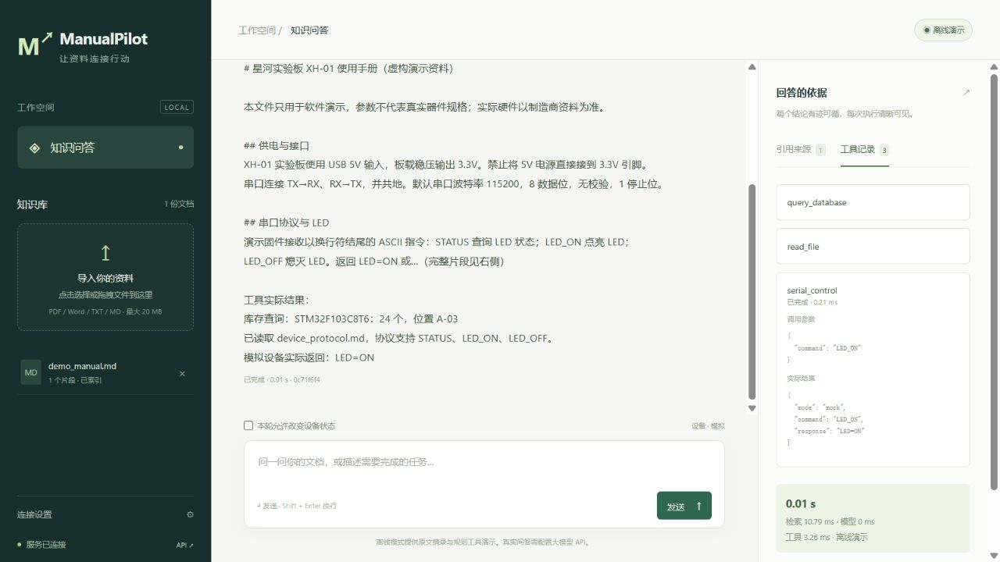

# 验收记录

本地验收环境：Windows，Python 3.14.6；依赖版本见 `uv.lock`。本文仅记录真实执行过的验证。

| 项目 | 结果与范围 |
| --- | --- |
| 静态检查 | Ruff lint、格式检查、前端 JavaScript 语法检查通过 |
| 自动化测试 | `pytest -q` 覆盖解析、检索、更新、工具与 API 协议；具体数量以运行输出为准 |
| HTTP 闭环 | 启动真实 Uvicorn 进程后，冒烟脚本完成检索、库存查询、协议读取、模拟串口控制及静态资源访问 |
| 浏览器联调 | 通过前端发送复合请求，实际显示库存 24、协议读取成功、模拟设备 `LED=ON`、引用及工具记录 |
| 延迟基准 | `benchmark-demo.json`：20 次采样、2 次预热、并发 1；只代表离线模式，不代表真实模型推理 |
| 大模型 API | HTTP mock 验证兼容协议及 4 轮请求（3 次工具 + 最终回答），未使用真实供应商密钥 |
| 真实串口 | 未连接硬件；已实现 pyserial 执行路径，尚待设备联调 |
| Docker | 本机没有 Docker；GitHub Actions 已成功构建镜像、启动容器并完成检索与三种工具的闭环冒烟测试 |

远端 [CI 验证记录](https://github.com/xiaoheibai567/xiaoheibai/actions/runs/42547882472)：
Python 3.11 / 3.12 / 3.14 三个测试任务及 Docker 任务均成功。源码提交为 `33133ba`；本文后续更新仅补记验收结果。

真实模型验收：配置 `.env` 的模型与 embedding 参数，改用新 `DATA_DIR` 导入目标资料，然后执行
`python scripts/benchmark.py --samples 20 --warmup 2 --output benchmark-api.json`。
只有输出的 `mode=api` 才代表实际模型接口测量。工具链需另选复合问题测量，不可把单次问答耗时套用于多轮调用。
